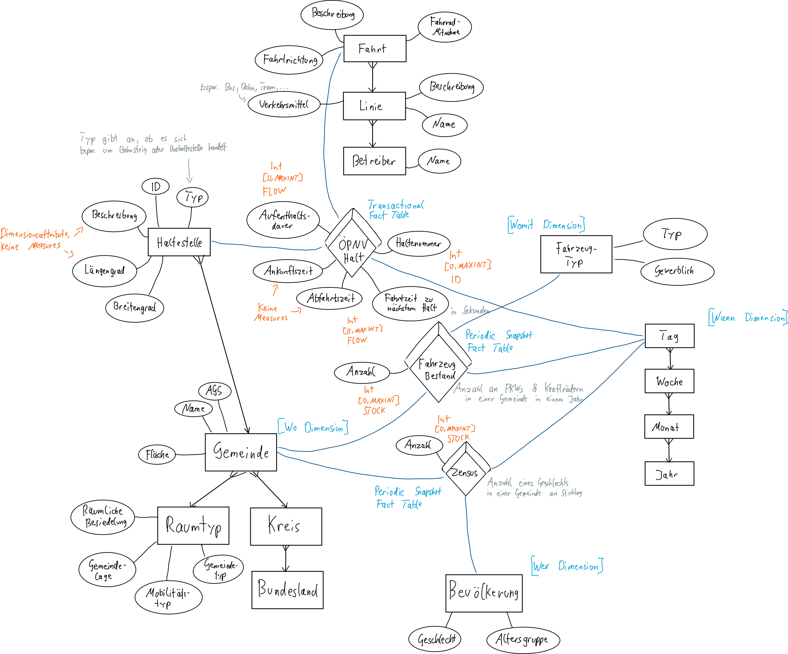

Data Warehousing | Summer Semester 2026 | Prof. Schildgen | OTH Regensburg

-----

**Name:** ️Nikolas Pollin

# Challenge 3: Data Modelling and Importing the Data

## Title

Auswirkungen des ÖPNV Angebots im ländlichen Raum


## Staging Area: Tables

```sql
CREATE TABLE Staging_Population (
  reporting_date         VARCHAR(15), -- I. d. R. immer der selbe Wert in allen Zeilen
  spatial_identification VARCHAR(8),  -- Kennziffer kann maximal 8 Zeichen lang sein (wegen DG Wert muss String verwendet werden)
  location_name          VARCHAR(100), -- Je nach Stufe bspw. "Deutschland", "Kelheim, Landkreis"
  age_group_name         VARCHAR(40),
  total_population       INTEGER,
  male_population        INTEGER,
  female_population      INTEGER
);

CREATE TABLE Staging_Registered_Vehicles (
  state_name VARCHAR(30),
  district VARCHAR(50),
  municipality VARCHAR(70),
  motorcycles VARCHAR(10),
  passenger_vehicles_total VARCHAR(10),
  passenger_vehicles_commercial VARCHAR(10)
);

CREATE TABLE Staging_Spatial_Classification (
  GEM2024 INTEGER, -- Amtlicher Gemeindeschlüssel (achtstellig)
  GEM_NAME VARCHAR(60), -- Gemeindename
  Bez_GEM VARCHAR(50), -- Gemeindeeinstufung
  fl24 DOUBLE, -- Fläche in km2
  KRS2024 INTEGER, -- Kreiskennziffer (Bestandteil des AGS)
  KRS_NAME VARCHAR(60),
  BLD2024 INTEGER, -- Bundesland-Kennziffer
  BLD_NAME VARCHAR(30),
  RBG2024 INTEGER,
  RGB_NAME VARCHAR(40),
  RLG2024 INTEGER,
  RLG_NAME VARCHAR(20),
  RS52024 INTEGER,
  RS5_NAME VARCHAR(50),
  GTU2024 INTEGER,
  GTU_NAME VARCHAR(30)
);


CREATE TABLE Staging_Extended_Stops (
  SeqNo VARCHAR(10), -- In CSV eindeutige ID
  Type CHAR(1), -- Art der Haltestelle (deckt sich mit location_type in stops.txt)
  DHID VARCHAR(60), -- Deutschlandweit eindeutige Haltestellen-ID
  Parent VARCHAR(60), -- Enthält DHID des Parents
  Name VARCHAR(80),
  Latitude VARCHAR(25), -- Nachkommastellen per Komma statt Punkt getrennt (daher String)
  Longitude VARCHAR(25),
  MunicipalityCode VARCHAR(8), -- AGS
  Municipality VARCHAR(60), -- Gemeindename
  DistrictCode VARCHAR(5),
  District VARCHAR(60),
  Description VARCHAR(200),
  Authority VARCHAR(30),
  DelfiName VARCHAR(80),
  SEV VARCHAR(15)
);

CREATE TABLE Staging_Stops (
  stop_id VARCHAR(60), -- Identisch zu DHID in Staging_Extended_Stops
  stop_name VARCHAR(80), -- Wesentlicher Name
  stop_description VARCHAR(200), -- Zusätzliche beschreibende Informationen
  stop_lat VARCHAR(25), -- Längengrad, gespeichert als String, mit Punt als Nachkommastellen-Trennsymbol
  stop_lon VARCHAR(25),
  location_type INTEGER, -- Enum Wert für Art der Haltestelle
  parent_station VARCHAR(60), -- Enthält stop_id bzw. DHID des Parents (Leeres Feld, falls kein Parent existiert)
  wheelchair_boarding INTEGER, -- Enum Wert
  platform_code VARCHAR(30)
);

CREATE TABLE Staging_Stop_Times (
  trip_id INTEGER, -- FK zu trips.txt
  stop_id VARCHAR(30), -- FK auf stops.txt (enthält DHID)
  stop_sequence INTEGER, -- Eindeutige Nummerierung eines Halts innerhalb einer Fahrt
  pickup_type INTEGER,
  drop_off_type INTEGER,
  arrival_time VARCHAR(8), -- Zeit in normaler Timestamp Formatierung (z. B. 08:18:30)
  departure_time VARCHAR(8)
);

CREATE TABLE Staging_Trips (
  route_id VARCHAR(60), -- FK auf routes.txt
  service_id INTEGER, -- FK auf calender.txt
  trip_id INTEGER,
  trip_headsign VARCHAR(100),
  trip_short_name VARCHAR(10),
  direction_id INTEGER,
  wheelchair_accessible INTEGER,
  bikes_allowed INTEGER
);

CREATE TABLE Staging_Frequencies (
  trip_id INTEGER, -- FK auf trips.txt
  start_time VARCHAR(8), -- Zeit in normaler Timestamp Formatierung (z. B. 08:18:30)
  end_time VARCHAR(8),
  headway_secs INTEGER
);

CREATE TABLE Staging_Calender (
  service_id INTEGER,
  monday INTEGER,
  tuesday INTEGER,
  wednesday INTEGER,
  thursday INTEGER,
  friday INTEGER,
  saturday INTEGER,
  sunday INTEGER,
  start_date VARCHAR(8), -- Datum im Format YYYYMMDD
  end_date VARCHAR(8)
);

CREATE TABLE Staging_Calender_Dates (
  service_id INTEGER, -- FK auf calender.txt
  "date" VARCHAR(8),
  exception_type INTEGER
);

CREATE TABLE Staging_Routes (
  route_id VARCHAR(60),
  agency_id INTEGER,
  route_short_name VARCHAR(50),
  route_long_name VARCHAR(250),
  route_type INTEGER
);

CREATE TABLE Staging_Agencies (
  agency_id INTEGER,
  agency_name VARCHAR(100)
);
```


## Forms of Heterogeneity

### Vergleich GTFS Daten mit Raumgliederung

- Technisch
  - Beide werden als fertig gepackte Datenpakete auf einem Webserver angeboten (File-Download).
  - GTFS Daten werden im CSV Format in TXT Files gezippt verteilt, während die Raumgliederungsdaten in einem Excel File gespeichert sind.
- Datenmodell
  - GTFS CSV Files sind Flat-Files ohne feste Struktur (bis auf den Header).
  - Raumgliederungsdaten sind in Excel enthalten und zählen daher eher als Spreadsheet-Modell.
- Syntaktisch
  - GTFS Daten speichern Gleitkommazahlen in amerikanischer Notation mit einem Punkt. Die Raumgliederung nutzt dafür ein Komma.
- Semantisch
  - Die GTFS Daten enthalten in dem erweiterten Haltestellen-Datensatz die amtlichen Gemeindeschlüssel (Referenz zur Gemeinde) als *Municipality Code*.
  - Der Raumgliederungs-Datensatz speichert diesen Wert als *Gemeinden-Kennziffer*.
- Schematisch
  - Sowohl die GTFS Daten als auch die Raumgliederung speichern einen geografischen Kontext.
  - GTFS speichert in den Hauptdaten zu einer Haltestelle nur die Koordinaten, nicht aber die Gemeindezugehörigkeit. Für die Zuordnung braucht man die erweiterten Haltestellen-Daten.
  - Die Raumgliederung speichert die geografische Zuordnung zu einer Gemeinde direkt als amtlichen Gemeindeschlüssel

### Vergleich der obigen mit den Fahrzeugzulassungen

- Technisch
  - Wird genauso wie die Raumgliederung als Excel File-Download angeboten (da Amt als Quelle).
- Datenmodell
  - Wird genau wie Raumgliederung als Excel gespeichert (Spreadsheet-Modell).
- Syntaktisch
  - Tausender Bereiche werden mit der deutschen Notation, also dem Punkt, getrennt.
- Semantisch
  - Amtlicher Gemeindeschlüssel ist zwar enthalten, wird allerdings zusammen mit Namen der Gemeinde in einem Feld kombiniert gespeichert (muss also aufgetrennt werden).


## Star / Snowflake Schema

**Fact table(s):**

```sql
CREATE TABLE Fact_Registered_Vehicles (
    municipality_code INTEGER REFERENCES Dim_Municipalities(municipality_code),
    vehicle_type_id INTEGER REFERENCES Dim_Vehicle_Type(vehicle_type_id),
    "date" DATE,
    amount INTEGER,
    PRIMARY KEY (municipality_code, vehicle_type_id, "date")
);

CREATE TABLE Fact_Census (
    municipality_code INTEGER REFERENCES Dim_Municipalities(municipality_code),
    population_group_id INTEGER REFERENCES Dim_Population(population_group_id),
    "date" DATE,
    amount INTEGER,
    PRIMARY KEY (municipality_code, population_group_id, "date")
);

CREATE TABLE Fact_Stops (
    station_id INTEGER REFERENCES Dim_Stations(station_id),
    trip_id INTEGER REFERENCES Dim_Trips(trip_id),
    "date" DATE, -- Konkreter Tag, an dem Fahrt stattfindet
    stop_sequence INTEGER, -- Position der Haltestelle in der konkreten Fahrt
    no_drop_off BOOLEAN,
    no_pick_up BOOLEAN,
    arrival_time_sec INTEGER, -- Zeit in Sekunden seit Mitternacht
    departure_time_sec INTEGER,
    duration_of_stay_sec INTEGER,
    duration_until_next_stop_sec INTEGER,
    -- PK enthält stop_sequence wegen bspw. Kreisfahrten und ähnlichem
    PRIMARY KEY (station_id, trip_id, "date", stop_sequence)
);
```

**Dimension table(s):**

```sql
CREATE TABLE Dim_Trips (
    trip_id INTEGER PRIMARY KEY,
    trip_headsign VARCHAR(100),
    trip_short_name VARCHAR(50),
    direction VARCHAR(10), -- Enum Werte VORWÄRTS, RÜCKWÄRTS
    wheelchair_accessible BOOLEAN,
    bikes_allowed BOOLEAN,

    -- Linie -> Hierarchiestufe
    route_short_name VARCHAR(50),
    route_long_name VARCHAR(100),
    transport_mode VARCHAR(20),
    -- ///

    -- Betreiber -> Hierarchiestufe
    agency_name VARCHAR(100)
    -- ///
);

CREATE TABLE Dim_Vehicle_Type (
    vehicle_type_id INTEGER PRIMARY KEY,
    type VARCHAR(20), -- bspw. Motorrad, LKW, PKW
    commercial BOOLEAN
);

CREATE TABLE Dim_Stations (
    station_id INTEGER PRIMARY KEY, -- Surrogatschlüssel
    municipality_code INTEGER REFERENCES Dim_Municipalities(municipality_code),
    dh_id VARCHAR(30), -- Deutschlandweite ID der Haltestellen
    name VARCHAR(80), -- Name der Haltestelle
    description VARCHAR(100), -- Zusätzliche Informationen zur Haltestelle
    type VARCHAR(40),
    latitude DOUBLE,
    longitude DOUBLE,
    wheelchair_accessible BOOLEAN,
    platform_code VARCHAR(30)
);

CREATE TABLE Dim_Municipalities (
    municipality_code INTEGER PRIMARY KEY, -- Amtlicher Gemeindeschlüssel
    name VARCHAR(60),
    description VARCHAR(50),
    area_km2 DOUBLE,

    -- Kreis --> Hierarchiestufe
    county_code INTEGER,
    county_name VARCHAR(60),
    -- ///

    -- Bundesland --> Hierarchiestufe
    state_code INTEGER,
    state_name VARCHAR(30),
    -- ///

    -- Raumtyp --> Hierarchiestufe
    spatial_settlement_code INTEGER, -- RBG
    spatial_settlement_desc VARCHAR(40),
    geographical_location_code INTEGER, -- RLG
    geographical_location_desc VARCHAR(20),
    spatial_typology_code INTEGER, -- RS5
    spatial_typology_desc VARCHAR(50),
    municipality_type_code INTEGER, -- GTU
    municipality_type_desc VARCHAR(30)
    -- ///
);

CREATE TABLE Dim_Population (
    population_group_id INTEGER PRIMARY KEY,
    gender VARCHAR(8), -- Männlich, Weiblich
    age_group_code VARCHAR(10), -- bspw. 00_TO_17
    age_group_desc VARCHAR(30),
    -- Für einfachere Queries
    min_age INTEGER,
    max_age INTEGER
);
```


## IMPORT

```sql
IMPORT INTO Staging_Frequencies (trip_id, start_time, end_time, headway_secs)
    FROM LOCAL CSV FILE '/Users/niki/Projekte/SQL/DW/dw-public-transportation/data_sources/frequencies.txt'
    (1, 2, 3, 4) ROW SEPARATOR = 'CRLF' SKIP  = 1 IGNORE CERTIFICATE
    ERRORS INTO error_tbl REJECT LIMIT UNLIMITED;


IMPORT INTO Staging_Trips (route_id, service_id, trip_id, trip_headsign, trip_short_name, direction_id, wheelchair_accessible, bikes_allowed)
    FROM LOCAL CSV FILE '/Users/niki/Projekte/SQL/DW/dw-public-transportation/data_sources/trips.txt'
    (1, 2, 3, 4, 5, 6, 9, 10) ROW SEPARATOR = 'CRLF' SKIP = 1 IGNORE CERTIFICATE
    ERRORS INTO error_tbl REJECT LIMIT UNLIMITED;


IMPORT INTO Staging_Routes (route_id, agency_id, route_short_name, route_long_name, route_type)
    FROM LOCAL CSV FILE '/Users/niki/Projekte/SQL/DW/dw-public-transportation/data_sources/routes.txt'
    (1, 2, 3, 4, 5) ROW SEPARATOR = 'CRLF' SKIP = 1 IGNORE CERTIFICATE
    ERRORS INTO error_tbl REJECT LIMIT UNLIMITED;


IMPORT INTO Staging_Agencies (agency_id, agency_name)
    FROM LOCAL CSV FILE '/Users/niki/Projekte/SQL/DW/dw-public-transportation/data_sources/agency.txt'
    (1, 2) ROW SEPARATOR = 'CRLF' SKIP = 1 IGNORE CERTIFICATE
    ERRORS INTO error_tbl REJECT LIMIT UNLIMITED;


IMPORT INTO Staging_Calender_Dates (service_id, "date", exception_type)
    FROM LOCAL CSV FILE '/Users/niki/Projekte/SQL/DW/dw-public-transportation/data_sources/calendar_dates.txt'
    ROW SEPARATOR = 'CRLF' SKIP = 1 IGNORE CERTIFICATE
    ERRORS INTO error_tbl REJECT LIMIT UNLIMITED;


IMPORT INTO Staging_Calender (service_id, monday, tuesday, wednesday, thursday, friday, saturday, sunday, start_date, end_date)
    FROM LOCAL CSV FILE '/Users/niki/Projekte/SQL/DW/dw-public-transportation/data_sources/calendar.txt'
    ROW SEPARATOR = 'CRLF' SKIP = 1 IGNORE CERTIFICATE
    ERRORS INTO error_tbl REJECT LIMIT UNLIMITED;


IMPORT INTO Staging_Stop_Times (trip_id, stop_id, stop_sequence, pickup_type, drop_off_type, arrival_time, departure_time)
    FROM LOCAL CSV FILE '/Users/niki/Projekte/SQL/DW/dw-public-transportation/data_sources/stop_times.txt'
    (1, 2, 3, 4, 5, 7, 8) ROW SEPARATOR = 'CRLF' SKIP = 1 IGNORE CERTIFICATE
    ERRORS INTO error_tbl REJECT LIMIT UNLIMITED;


IMPORT INTO Staging_Stops (stop_id, stop_name, stop_description, stop_lat, stop_lon, location_type, parent_station, wheelchair_boarding, platform_code)
    FROM LOCAL CSV FILE '/Users/niki/Projekte/SQL/DW/dw-public-transportation/data_sources/stops.txt'
    (1, 3, 4, 5, 6, 7, 8, 9, 10) ROW SEPARATOR = 'CRLF' SKIP = 1 IGNORE CERTIFICATE
    ERRORS INTO error_tbl REJECT LIMIT UNLIMITED;


IMPORT INTO Staging_Extended_Stops (seqno, type, dhid, parent, name, latitude, longitude, municipalitycode, municipality, districtcode, district, description, authority, delfiname, sev)
    FROM LOCAL CSV FILE '/Users/niki/Projekte/SQL/DW/dw-public-transportation/data_sources/extended_stops.csv'
    (1, 2, 3, 4, 5, 6, 7, 8, 9, 10, 11, 12, 13, 14, 18) ROW SEPARATOR  = 'CRLF' NULL = '-' COLUMN SEPARATOR = ';' SKIP = 1 IGNORE CERTIFICATE
    ERRORS INTO error_tbl REJECT LIMIT UNLIMITED;


IMPORT INTO Staging_Registered_Vehicles (state_name, district, municipality, motorcycles, passenger_vehicles_total, passenger_vehicles_commercial)
    FROM LOCAL CSV FILE '/Users/niki/Projekte/SQL/DW/dw-public-transportation/data_sources/registered_vehicles_flat.csv'
    (1, 2, 3, 4, 5, 6) ROW SEPARATOR = 'LF' COLUMN SEPARATOR = ';' SKIP = 1 IGNORE CERTIFICATE
    ERRORS INTO error_tbl REJECT LIMIT UNLIMITED;


IMPORT INTO Staging_Population (reporting_date, spatial_identification, location_name, age_group_name, total_population, male_population, female_population)
    FROM LOCAL CSV FILE '/Users/niki/Projekte/SQL/DW/dw-public-transportation/data_sources/population.csv'
    ROW SEPARATOR = 'LF' COLUMN SEPARATOR = ';' NULL = '-' IGNORE CERTIFICATE
    ERRORS INTO error_tbl REJECT LIMIT UNLIMITED;


IMPORT INTO Staging_Spatial_Classification (gem2024, gem_name, bez_gem, fl24, krs2024, krs_name, rbg2024, rgb_name, rlg2024, rlg_name, rs52024, rs5_name, gtu2024, gtu_name, bld2024, bld_name)
    FROM LOCAL CSV FILE '/Users/niki/Projekte/SQL/DW/dw-public-transportation/data_sources/spatial_classification_flat.csv'
    (1, 3, 4, 6, 13, 14, 33, 34, 37, 38, 41, 42, 57, 58, 91, 92) ROW SEPARATOR = 'LF' COLUMN SEPARATOR = ';' SKIP = 1 IGNORE CERTIFICATE
    ERRORS INTO error_tbl REJECT LIMIT UNLIMITED;
```


## Numbers

#### Tabelle mit meisten Einträgen
GTFS stop_times.txt bzw. Staging_Stop_Times mit 45.051.926 Zeilen 

#### Tabelle mit größter Speichergröße
GTFS stop_times.txt bzw. Staging_Stop_Times mit ca 2,7 GB

#### Gesamtgröße des Schemas
Ca. 3,7 GB


## ME/R Model

